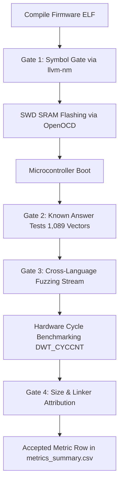

# Benchmarking Lightweight Cryptography Across Programming Languages on Bare-Metal Microcontrollers: Empirical Methodology
*Physical Silicon Evaluation (ARM Cortex-M33) and Architectural Emulation (ARMv8-M & RISC-V RV32)*

---

## 1. Research Question & Scope

This study investigates an empirical systems question:
> **How do programming languages (C, C++, Rust, and Zig), compiler toolchains, and runtime safety invariants affect the cycle performance, binary footprint, and stack memory consumption of standardized lightweight cryptographic (LWC) ciphers on 32-bit bare-metal microcontroller silicon?**

To isolate language and compiler semantics from algorithmic variances, the following dimensions are strictly controlled:
- **Identical Core Algorithms:** All backends implement the identical mathematical primitives and state loop structures:
  - **SIMON-64/128:** 64-bit block, 128-bit key, 44 rounds (balanced Feistel cipher built from 32-bit word rotations).
  - **PRESENT-80:** 64-bit block, 80-bit key, 31 rounds (SPN block cipher with a bit-by-bit permutation layer testing compiler lowering of bit-manipulation loops).
  - **Ascon-AEAD128 (NIST SP 800-232):** 128-bit key, 128-bit nonce, 128-bit tag, 128-bit rate, 320-bit state ($p^{12}$ initialization/finalization, $p^8$ round permutation).
- **Uniform C ABI Boundary:** Every backend exports the standard C prototypes defined in [`ciphers/include/lwc_api.h`](file:///c:/code/research/paper_2/lwc-lang-bench-fixed/ciphers/include/lwc_api.h) under a unique prefix (`lwc_c_`, `lwc_cpp_`, `lwc_rs_`, `lwc_rso_`, `lwc_zig_`).
- **Single-Backend Hermetic Firmware Images:** Exactly one cipher backend is compiled and linked into each firmware binary alongside a constant harness compiled with Clang `-O2`.
- **Dual Execution Environments:**
  - **Physical Microcontroller Silicon (`env=hardware`):** Real-world cycle counts via `DWT_CYCCNT` on **Raspberry Pi Pico 2 (RP2350, ARM Cortex-M33 @ 12 MHz)** loaded into SRAM over SWD via OpenOCD.
  - **Deterministic Virtual Emulation (`env=qemu`):** Instruction counts under QEMU `-icount` across ARM Cortex-M33 (`armv8m`) and 32-bit RISC-V (`rv32imac` baseline and `rv32imac_zbb` with bit-manipulation extensions). This isolates architectural differences (such as operand-folded rotates on Arm versus native rotate (Zbb) on RISC-V) from physical silicon variations.

---

## 2. Language Backends & Architectural Implementations

The benchmark evaluates five discrete backend paradigms:

| Backend ID | Language | Standard / Dialect | Prefix | Philosophy & Memory Model |
| :--- | :--- | :--- | :--- | :--- |
| **`c`** | C | C99 (Freestanding) | `lwc_c_` | Idiomatic embedded C; raw pointers; manual buffer boundaries. |
| **`cpp`** | C++ | C++17 (Freestanding) | `lwc_cpp_` | Zero-overhead abstractions; `constexpr` lookup tables; no RTTI, no exceptions. |
| **`rust`** | Rust (Safe) | Rust 2021 (`#![no_std]`) | `lwc_rs_` | Idiomatic safe Rust; `#![forbid(unsafe_op_in_unsafe_fn)]`; non-null slice references (`&[u8]`); runtime slice bounds checking; no forced inlining. |
| **`rust_opt`**| Rust (Opt) | Rust 2021 (`#![no_std]`) | `lwc_rso_` | **Unconstrained bare-metal idiom:** Raw pointers (`*const u8`, `*mut u8`), 64-bit unaligned word loads (`read_unaligned`), and unchecked indexing (`get_unchecked`). Reflects unrestricted embedded systems practice. *(Note: Because `rust_opt` compounds multiple optimizations simultaneously, it represents an idiomatic paradigm rather than an isolated single-variable safety ablation; the dedicated safety ablation is provided by the `-ovf` suite).* |
| **`zig`** | Zig | Zig 0.16.0 (Freestanding) | `lwc_zig_` | Direct slice indexing; comptime code generation; `std.debug.no_panic` traps on safety failure. |

---

## 3. Optimization Classes & Safety Matrix

Compilers and profiles are grouped into comparable optimization classes to decouple speed optimization from safety guarantees:

```
+---------------------------------------------------------------------------------------------------+
| Profile / Optimization Matrix                                                                     |
+-------------------+----------------+--------------------------------------------------------------+
| Opt Class         | Target Profile | Toolchains & Applied Flags                                   |
+-------------------+----------------+--------------------------------------------------------------+
| O3 (Throughput)   | C (GCC)        | arm-none-eabi-gcc -O3                                        |
|                   | C (Clang)      | clang --target=thumbv8m.main-none-eabi -O3                   |
|                   | C++ (GCC)      | arm-none-eabi-g++ -O3 -std=c++17 -ffreestanding              |
|                   | C++ (Clang)    | clang++ --target=thumbv8m.main-none-eabi -O3 -std=c++17      |
|                   | Rust (Safe)    | rustc opt-level=3, overflow-checks=false, bounds=checked     |
|                   | Rust (Safe-ovf)| rustc opt-level=3, overflow-checks=true, bounds=checked      |
|                   | Rust (Opt)     | rustc opt-level=3, unchecked pointers, bounds=unchecked      |
|                   | Zig (Fast)     | zig -O ReleaseFast (safety=none)                             |
|                   | Zig (Safe)     | zig -O ReleaseSafe (safety=all: bounds, overflow, alignment) |
+-------------------+----------------+--------------------------------------------------------------+
| Oz (Code Size)    | C (GCC)        | arm-none-eabi-gcc -Oz                                        |
|                   | C (Clang)      | clang --target=thumbv8m.main-none-eabi -Oz                   |
|                   | C++ (GCC)      | arm-none-eabi-g++ -Oz -std=c++17 -ffreestanding              |
|                   | C++ (Clang)    | clang++ --target=thumbv8m.main-none-eabi -Oz -std=c++17      |
|                   | Rust (Safe)    | rustc opt-level="z", overflow-checks=false, bounds=checked   |
|                   | Rust (Safe-ovf)| rustc opt-level="z", overflow-checks=true, bounds=checked    |
|                   | Rust (Opt)     | rustc opt-level="z", unchecked pointers, bounds=unchecked    |
|                   | Zig (Small)    | zig -O ReleaseSmall (safety=none)                            |
+-------------------+----------------+--------------------------------------------------------------+
```

### Safety Categories
- **`none`:** No runtime bounds checks or arithmetic traps (C, C++, Zig ReleaseFast/Small).
- **`bounds`:** Mandatory slice index verification enforced at runtime (Safe Rust).
- **`bounds+overflow`:** Both slice indexing and arithmetic wrap traps active (Safe Rust `-ovf`).
- **`all`:** Exhaustive undefined-behavior traps: bounds, overflow, unaligned pointer dereference, and type assertions (Zig ReleaseSafe).
- **`unchecked`:** Direct pointer dereferences without defensive branching or slice bounds validation (`Rust (opt)`).

### Arithmetic Overflow & Language Safety Semantics

#### 1. What is Integer Overflow in Embedded Cryptography?
Integer overflow occurs when an arithmetic operation produces a result exceeding the register's representable range (e.g. `0xFFFF_FFFF + 1` in a 32-bit register). In cryptographic implementations, unexpected overflow can result in buffer indexing errors, incorrect state transformations, or timing side-channels.

#### 2. The Rust `-ovf` Cells (`rustc-O3-ovf`, `rustc-Oz-ovf`)
- **Default Release Behavior:** In standard Rust release profiles (`-O3`, `-Oz`), arithmetic overflow checks are **disabled by default** (`overflow-checks = false`) to optimize raw execution speed, allowing arithmetic to silently wrap modulo $2^N$ using two's complement.
- **Checked Profile:** By compiling with `-C overflow-checks=on`, the `-ovf` cells force LLVM to emit overflow-detecting intrinsics (`@llvm.uadd.with.overflow.*`, `@llvm.umul.with.overflow.*`). If an unexpected overflow occurs, the binary immediately triggers a deterministic hardware trap (`lwc_panic`).
- **Research Value:** Including both standard Rust (`Safe`) and overflow-checked Rust (`Safe-ovf`) allows this benchmark to empirically isolate the exact cycle and code size tax of runtime arithmetic safety in production embedded firmware.

#### 3. Why Are There No "C/C++ ovf" Cells?
- **Unsigned Standard Semantics:** Under ISO C99 and C++17, unsigned integer arithmetic is strictly defined to wrap modulo $2^N$; it is neither undefined behavior (UB) nor a trappable error. Because cryptographic ciphers operate almost exclusively on unsigned words (`uint32_t`, `uint64_t`), C/C++ compilers never emit overflow checks for these types.
- **Freestanding Bare-Metal Constraints:** While GCC and Clang provide UndefinedBehaviorSanitizer (`-fsanitize=integer-overflow`), the sanitizer requires the host runtime `libubsan` (POSIX libc, dynamic memory, file I/O, stack unwinding). In freestanding microcontroller environments (`-ffreestanding`, `-nostdinc++`), `libubsan` cannot be linked into SRAM without an entire operating system abstraction layer. GCC's `-ftrapv` only traps on *signed* integer overflow, leaving unsigned cryptographic operations unaffected.

#### 4. Zig's Built-In Overflow Protection
Zig provides first-class language-level overflow protection. In `ReleaseSafe`, Zig lowers arithmetic operations to checked overflow intrinsics and routes errors through `std.debug.no_panic`, halting on microcontrollers without requiring external runtime libraries. In `ReleaseFast` and `ReleaseSmall`, arithmetic overflow checks are disabled for speed and size.

---

## 4. Verification Gates & Methodological Controls

To prevent experimental contamination, flawed benchmarking runs, or misattributed results, every cell must pass **four strict automated verification gates**:



### Gate 1: Symbol Purity Gate (`check_symbols.py`)
Using `llvm-nm -S --defined-only`, the linked firmware image is inspected to verify:
1. All 8 required cipher API symbols for the target language exist as defined functions with non-zero size.
2. Zero symbols with another backend's prefix exist in the binary.
3. No legacy un-prefixed entry points (`lwc_ascon128_...`) are linked.

### Gate 2: Known-Answer Tests (On-Chip KATs)
Inside every running image, before timing commences, the firmware executes:
- SIMON-64/128 official block test vectors.
- PRESENT-80 official block test vectors.
- **All 1,089 official NIST SP 800-232 test vectors for Ascon-AEAD128**:
  - Full encryption verification across message sizes 0 to 1,024 bytes and associated data 0 to 48 bytes.
  - Full decryption verification.
  - Tag corruption test (`bad_tag[15] ^= 0x80`): The cipher must return `LWC_ERR_AUTH_FAIL` **and wipe the plaintext buffer to 0**. Any failure immediately halts the image before benchmarking.

### Gate 3: Differential Fuzzing Integrity
- **Host Differential Fuzz:** 10,000 randomized iterations across C, C++, Rust, Rust (opt), and Zig shared libraries verifying bit-identical output.
- **On-Chip Deterministic Fuzz:** A 1,000-iteration PRNG stream (xorshift32) is processed on-chip and hashed into an FNV-1a digest. The output must match `build/host/fuzz_digest.json` across all backends.

### Gate 4: Static Memory Attribution & Size Report (`size_report.py`)
The GNU/LLD linker map (`-Map=firmware.map`) is parsed with section-level granularity after garbage collection (`--gc-sections`):
- `backend`: Text, rodata, and data sections strictly belonging to the cipher algorithms.
- `backend_runtime`: Language runtime pulled in by the backend (e.g., Rust `compiler_builtins`, `core`).
- `harness_runtime`: Standard runtime helpers (`memcpy`, `memset`, 64-bit shifts `__aeabi_llsl`).
- `harness_kat`: Test vectors and validation logic.

---

## 5. Physical Silicon Execution Setup

```
[Workstation / Runner Script]
       |
       | USB CMSIS-DAP (OpenOCD @ 5000 kHz)
       v
[Raspberry Pi Debug Probe]
       |
       | SWD (SWCLK / SWDIO / GND)
       v
[Raspberry Pi Pico 2 (RP2350)]
       |-- Core: ARM Cortex-M33 @ 12.0 MHz (Direct Crystal, zero jitter)
       |-- Boot Mode: SRAM Executable (0x20000000, zero wait states)
       |-- Cycle Counter: DWT_CYCCNT (ARM Data Watchpoint & Trace)
       |
       | UART0 TX (GP0, 115200 8N1)
       v
[Pyserial Log Capture -> parse_log.py]
```

### Hardware Constraints & Timing Configuration
1. **SRAM Execution & Flash/XIP Decoupling:**
   Firmware images are loaded directly into internal SRAM (0x20000000) via OpenOCD. Because execution occurs entirely from SRAM, flash wait states and XIP cache misses are not on the timing path.
2. **Dedicated ARM Cortex-M33 Silicon Execution & RISC-V SWD Architectural Finding:**
   The RP2350 microcontroller powers on in ARM mode by default with the Hazard3 RISC-V cores clock-gated. During hardware trials, loading RISC-V images directly into SRAM over SWD via OpenOCD failed because OpenOCD was unable to examine the unclocked `rp2350.rv0` core. On the RP2350, switching the active core requires the internal Bootrom to parse a UF2 image containing an `IMAGE_DEF` block, which bypasses the direct zero-wait-state SWD SRAM test harness. Rather than introducing flash execution latency and bootrom timing jitter, physical silicon measurements focus strictly on the ARM Cortex-M33 core, while cross-ISA architectural evaluation (RV32 baseline without rotate vs. RV32+Zbb with rotate extension) is conducted systematically under deterministic QEMU instruction counting.
3. **Fixed Clock Source:**
   Core clock is pinned at 12 MHz directly from the external crystal oscillator (`clk_sys = clk_ref = 12 MHz`, PLL disabled).
4. **Cycle Counter Precision:**
   Execution time is recorded via the hardware cycle counter (`DWT_CYCCNT`) on ARM Cortex-M33, configured and enabled by the startup harness. Back-to-back counter reads measure timer overhead, which is subtracted from raw measurements.
5. **Statistical Aggregation & Deterministic Protocol:**
   Each cipher operation is executed over 10 batches of 100 timed iterations (1,000 calls per operation) with distinct pseudo-random inputs per iteration. Across repeated physical image flashes on silicon, measurements demonstrated 0.00% cycle jitter on SIMON and Ascon, and at most 0.06% on PRESENT. Because bare-metal SRAM execution at 12 MHz crystal clock with interrupts disabled is completely deterministic, single-image loads with 1,000 internal iterations provide exact metrics without need for statistical confidence intervals. The median execution cycle count is reported as the primary metric.

---

## 6. Stack Depth Watermarking Methodology

Stack memory depth is measured dynamically on the microcontroller:
1. **Stack Painting:** Before calling the cipher entry point, the unused stack space below the current stack pointer is filled with a known 32-bit pattern (`0xA5A5A5A5`).
2. **Single-Invocation Execution:** One timed call is executed.
3. **Watermark Scanning:** The stack memory is inspected from the bottom upward to identify the lowest overwritten address.
4. **Baseline Subtraction:** The static overhead of an empty probe invocation (`EMPTY_PROBE`) is subtracted to yield the exact net stack memory consumed by the cipher backend.

---

## 7. Comparative Physical Hardware Findings (RP2350 Cortex-M33)

Empirical data recorded during run `20261021T214313Z` across all 17 ARM Cortex-M33 physical hardware cells (all 4 verification gates passed, 238 rows accepted):

| Target Cell | Profile / Safety | SIMON-64 Enc (cycles) | PRESENT-80 Enc (cycles) | ASCON 1KB Enc (cycles) | ASCON 1KB Dec (cycles) | Net Stack Usage (Bytes) | Backend Flash (Bytes) | Total Linked Flash (Bytes)* |
| :--- | :--- | :---: | :---: | :---: | :---: | :---: | :---: | :---: |
| **`c-gcc-O3`** | Speed / none | 510 | 64,845 | **65,727** | **65,598** | **124 B** | 8,814 | 8,814 |
| **`c-clang-O3`** | Speed / none | **427** | 59,445 | 70,168 | 69,886 | 232 B | 10,756 | 10,756 |
| **`cpp-gcc-O3`** | Speed / none | 510 | 64,844 | **65,727** | **65,598** | **124 B** | 8,814 | 8,814 |
| **`cpp-clang-O3`** | Speed / none | **427** | 59,447 | 70,168 | 69,886 | 232 B | 10,756 | 10,756 |
| **`rust-rustc-O3`** *(Safe)* | Speed / bounds | 433 | 67,707 | 69,655 | 71,848 | 236 B | 11,506 | 11,506 |
| **`rust-rustc-O3-ovf`** *(Safe+ovf)* | Speed / bounds+ovf | 433 | **59,246** | 74,024 | 73,641 | 224 B | 9,164 | 9,164 |
| **`rust_opt-rustc-O3`** *(Opt)* | Speed / unchecked | 433 | 67,707 | 73,205 | 73,444 | 240 B | 11,426 | 11,426 |
| **`zig-zig-ReleaseFast`** | Speed / none | 433 | 59,406 | 73,212 | 71,557 | 300 B | 10,534 | 10,534 |
| **`zig-zig-ReleaseSafe`** | Speed / all | 433 | 59,402 | 75,789 | 70,745 | 296 B | 9,820 | 9,820 |
| | | | | | | | | |
| **`c-gcc-Oz`** | Size / none | 577 | 74,649 | 87,689 | 88,074 | 252 B | 3,600 | 3,600 |
| **`c-clang-Oz`** | Size / none | 605 | 110,006 | 87,988 | 87,850 | 256 B | 2,930 | 2,930 |
| **`cpp-gcc-Oz`** | Size / none | 584 | 76,108 | 87,752 | 88,330 | 252 B | 3,616 | 3,616 |
| **`cpp-clang-Oz`** | Size / none | **604** | 116,727 | 87,724 | 87,906 | 256 B | 2,854 | 2,854 |
| **`rust-rustc-Oz`** *(Safe)* | Size / bounds | 751 | 115,761 | 109,349 | 109,290 | 268 B | 4,540 | 7,218* |
| **`rust-rustc-Oz-ovf`** *(Safe+ovf)* | Size / bounds+ovf | 751 | 114,682 | 109,551 | 109,493 | 272 B | 4,628 | 7,417* |
| **`rust_opt-rustc-Oz`** *(Opt)* | Size / unchecked | 611 | 115,633 | **86,202** | **86,219** | 268 B | 2,906 | 2,906 |
| **`zig-zig-ReleaseSmall`** | Size / none | 605 | 119,540 | **84,538** | **84,493** | 256 B | **2,780** | **2,780** |

*\*Total Linked Flash includes `backend_runtime_flash` (e.g. 2,678 B of `compiler_builtins` / `core` runtime linked by Safe Rust `-Oz`).*

### Key Empirical Observations
1. **Inlining Policy & Code Size at -Oz:** Converting `#[inline(always)]` to advisory `#[inline]` in `ciphers/rust_opt` enabled LLVM to optimize for code size under `-Oz`. Backend flash dropped from **6,752 B down to 2,906 B (-57%)**, achieving footprint and throughput comparable to C Clang `-Oz` (2,930 B and 87,988 cycles) and beating C GCC `-Oz` (3,600 B and 87,689 cycles). Meanwhile, Zig `ReleaseSmall` produced the single most compact binary (**2,780 B**) and fastest size-optimized throughput on Ascon (**84,538 cycles**) across all evaluated backends.
2. **Stack Attribution & Safety Invariants:** `Rust (opt)` `-O3` stack depth measured **240 B**, closely aligning with Safe Rust (**236 B**) and Clang C (**232 B**). This empirical result does not support the hypothesis that Rust's stack usage is inherently inflated by language safety invariants or slice bounds checks. Instead, stack depth in this workload is predominantly governed by compiler call-frame layout and helper inlining decisions (e.g. LLVM allocating ~232–240 B with an out-of-line `ascon_absorb_ad` frame, while GCC inlines it and allocates 124 B).
3. **C++ Abstraction Overheads:** At `-O3`, freestanding C++17 matches C cycle-for-cycle and byte-for-byte under both GCC (510 SIMON, 65,727 Ascon 1KB; 8,814 B Flash) and Clang (427 SIMON, 70,168 Ascon 1KB; 10,756 B Flash). At `-Oz`, minor compiler code-generation divergences emerge on the bit-permutation layer of PRESENT-80 (+6.1% cycles in Clang, +2.0% in GCC), while SIMON and Ascon remain within 0.1% of C.
4. **Rust Overflow Checks & The PRESENT-80 Compiler Effect:** Enabling arithmetic overflow checks (`-ovf`) added 0% overhead on SIMON-64 (433 vs 433 cycles) and a modest 6.2% overhead on Ascon-1024B (74,024 vs 69,655 cycles). Counter-intuitively, on PRESENT-80, the overflow-checked binary executed **12.5% faster** on silicon (59,246 vs 67,707 cycles) and compiled **20.4% smaller** (9,164 B vs 11,506 B), mirroring a 19.1% instruction reduction in QEMU (55,221 vs 68,240 instructions). Observed disassembly reveals that LLVM generated two distinct loop-unrolling sequences for the `% 63` bit-permutation: the unchecked build emitted a 423-instruction sequence with 32-bit `umull` operations and stack spills, while the checked build emitted a 351-instruction sequence using 16-bit multiplies (`uxth; mul`). While we hypothesize that overflow tracking altered the cost model for lowering `(i * 16) % 63`, the exact compiler heuristic linking the overflow intrinsic to this instruction selection remains unproven, and this variance is reported strictly as an observed compiler artifact rather than an inherent performance benefit of runtime safety.
5. **Zig Safety Efficiency:** Zig `ReleaseSafe` runtime checks incurred zero performance penalty on SIMON (433 vs 433 cycles) and PRESENT (59,402 vs 59,406 cycles), and a measured 3.5% cycle overhead (6.8% in QEMU instructions) on Ascon-1024B encryption.

---

## 8. Threats to Validity & Mitigation

1. **Host-Target Compiler Drift:** Backends use different frontend versions (GCC 15.2, Clang 23.1, rustc 1.99 / LLVM 23.1, Zig 0.16 / LLVM 21.1).  
   *Mitigation:* Tool versions and exact command-line invocations are embedded in the binary metadata (`build_info.h`) and recorded in `manifest.json`.
2. **Inlining Artifacts:** Forced inlining (`always_inline`) artificially inflates code size.  
   *Mitigation:* Strict natural inlining policy across all languages: advisory hints only (`inline`, `#[inline]`, standard Zig `fn`); no forced inlining.
3. **Microarchitectural Contamination & Flash Wait States:** Memory bank conflicts or cache misses altering execution time.  
   *Mitigation:* Code is executed strictly from internal SRAM banks (0x20000000) with zero flash accesses; interrupts are disabled throughout measurement loops.
4. **Instruction Count vs. Silicon Cycle Count Discrepancies:** QEMU instruction counts cannot model microarchitectural pipeline efficiency.  
   *Mitigation:* Disassembly of SIMON-64 reveals that while GCC executes 1.49× more instructions than Clang (due to maintaining a 1-round loop vs. Clang's 4-round unrolling and `ldrd`/`ldm` pair-loads), GCC incurs only 1.19× the cycles on hardware. The Cortex-M33 hardware pipeline executes GCC's simple register moves with a lower Cycles-Per-Instruction (CPI: 1.11 for GCC vs 1.38 for LLVM), demonstrating the critical value of complementary physical silicon benchmarking.
