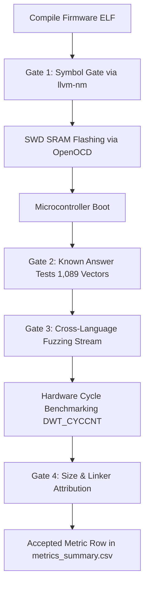

# Benchmarking Lightweight Cryptography Across Programming Languages on Bare-Metal Microcontrollers: Empirical Methodology

---

## 1. Research Question & Scope

This study investigates an empirical systems question:
> **How do programming languages (C, C++, Rust, and Zig), compiler toolchains, and runtime safety invariants affect the cycle performance, binary footprint, and stack memory consumption of standardized lightweight cryptographic (LWC) ciphers on 32-bit bare-metal microcontroller silicon?**

To isolate language and compiler semantics from algorithmic variances, the following dimensions are strictly controlled:
- **Identical Core Algorithms:** All backends implement the identical mathematical primitives and state loop structures:
  - **SIMON-64/128:** 64-bit block, 128-bit key, 44 rounds (balanced Feistel cipher built from 32-bit word rotations).
  - **PRESENT-80:** 64-bit block, 80-bit key, 31 rounds (SPN block cipher with a bit-by-bit permutation layer testing compiler lowering of bit-manipulation loops).
  - **ASCON-128 (NIST SP 800-232):** 128-bit key, 128-bit nonce, 128-bit tag, 128-bit rate, 320-bit state ($p^{12}$ initialization/finalization, $p^8$ round permutation).
- **Uniform C ABI Boundary:** Every backend exports the standard C prototypes defined in [`ciphers/include/lwc_api.h`](file:///c:/code/research/paper_2/lwc-lang-bench-fixed/ciphers/include/lwc_api.h) under a unique prefix (`lwc_c_`, `lwc_cpp_`, `lwc_rs_`, `lwc_rso_`, `lwc_zig_`).
- **Single-Backend Hermetic Firmware Images:** Exactly one cipher backend is compiled and linked into each firmware binary alongside a constant harness compiled with Clang `-O2`.
- **Dual Execution Environments:** Evaluated in both virtual instruction-counting simulation (QEMU) and on physical ARM Cortex-M33 silicon (Raspberry Pi Pico 2).

---

## 2. Language Backends & Architectural Implementations

The benchmark evaluates five discrete backend paradigms:

| Backend ID | Language | Standard / Dialect | Prefix | Philosophy & Memory Model |
| :--- | :--- | :--- | :--- | :--- |
| **`c`** | C | C99 (Freestanding) | `lwc_c_` | Idiomatic embedded C; raw pointers; manual buffer boundaries. |
| **`cpp`** | C++ | C++17 (Freestanding) | `lwc_cpp_` | Zero-overhead abstractions; `constexpr` lookup tables; no RTTI, no exceptions. |
| **`rust`** | Rust (Safe) | Rust 2021 (`#![no_std]`) | `lwc_rs_` | `#![forbid(unsafe_op_in_unsafe_fn)]`; non-null slice references (`&[u8]`); runtime slice bounds checking; no forced inlining. |
| **`rust_opt`**| Rust (Opt) | Rust 2021 (`#![no_std]`) | `lwc_rso_` | Unconstrained hardware-optimized Rust; raw pointers (`*const u8`, `*mut u8`); unaligned word loads (`read_unaligned`); unchecked table lookups (`get_unchecked`); constant-time tag check with plaintext zeroing on authentication failure. |
| **`zig`** | Zig | Zig 0.16.0 (Freestanding) | `lwc_zig_` | Direct slice indexing; comptime code generation; `std.debug.no_panic` traps on safety failure. |

---

## 3. Optimization Classes & Safety Matrix

Compilers and profiles are grouped into comparable optimization classes to decouple speed optimization from safety guarantees:

```
+---------------------------------------------------------------------------------------------------+
| Profile / Optimization Matrix                                                                     |
+-------------------+----------------+--------------------------------------------------------------+
| Opt Class         | Target Profile | Toolchains & Applied Flags                                   |
+-------------------+----------------+--------------------------------------------------------------+
| O3 (Throughput)   | C (GCC)        | arm-none-eabi-gcc -O3                                        |
|                   | C (Clang)      | clang --target=thumbv8m.main-none-eabi -O3                   |
|                   | Rust (Safe)    | rustc opt-level=3, overflow-checks=false, bounds=checked     |
|                   | Rust (Safe-ovf)| rustc opt-level=3, overflow-checks=true, bounds=checked      |
|                   | Rust (Opt)     | rustc opt-level=3, unchecked pointers, bounds=unchecked      |
|                   | Zig (Fast)     | zig -O ReleaseFast (safety=none)                             |
|                   | Zig (Safe)     | zig -O ReleaseSafe (safety=all: bounds, overflow, alignment) |
+-------------------+----------------+--------------------------------------------------------------+
| Oz (Code Size)    | C (GCC)        | arm-none-eabi-gcc -Oz                                        |
|                   | C (Clang)      | clang --target=thumbv8m.main-none-eabi -Oz                   |
|                   | Rust (Safe)    | rustc opt-level="z", overflow-checks=false, bounds=checked   |
|                   | Rust (Opt)     | rustc opt-level="z", unchecked pointers, bounds=unchecked    |
|                   | Zig (Small)    | zig -O ReleaseSmall (safety=none)                            |
+-------------------+----------------+--------------------------------------------------------------+
```

### Safety Categories
- **`none`:** No runtime bounds checks or arithmetic traps (C, C++, Zig ReleaseFast/Small).
- **`bounds`:** Mandatory slice index verification enforced at runtime (Safe Rust).
- **`bounds+overflow`:** Both slice indexing and arithmetic wrap traps active (Safe Rust `-ovf`).
- **`all`:** Exhaustive undefined-behavior traps: bounds, overflow, unaligned pointer dereference, and type assertions (Zig ReleaseSafe).
- **`unchecked`:** Direct pointer dereferences without defensive branching or slice bounds validation (`Rust (opt)`).

---

## 4. Verification Gates & Methodological Controls

To prevent experimental contamination, flawed benchmarking runs, or misattributed results, every cell must pass **four strict automated verification gates**:



### Gate 1: Symbol Purity Gate (`check_symbols.py`)
Using `llvm-nm -S --defined-only`, the linked firmware image is inspected to verify:
1. All 8 required cipher API symbols for the target language exist as defined functions with non-zero size.
2. Zero symbols with another backend's prefix exist in the binary.
3. No legacy un-prefixed entry points (`lwc_ascon128_...`) are linked.

### Gate 2: Known-Answer Tests (On-Chip KATs)
Inside every running image, before timing commences, the firmware executes:
- SIMON-64/128 official block test vectors.
- PRESENT-80 official block test vectors.
- **All 1,089 official NIST SP 800-232 test vectors for Ascon-AEAD128**:
  - Full encryption verification across message sizes 0 to 1,024 bytes and associated data 0 to 48 bytes.
  - Full decryption verification.
  - Tag corruption test (`bad_tag[15] ^= 0x80`): The cipher must return `LWC_ERR_AUTH_FAIL` **and wipe the plaintext buffer to 0**. Any failure immediately halts the image before benchmarking.

### Gate 3: Differential Fuzzing Integrity
- **Host Differential Fuzz:** 10,000 randomized iterations across C, C++, Rust, Rust (opt), and Zig shared libraries verifying bit-identical output.
- **On-Chip Deterministic Fuzz:** A 1,000-iteration PRNG stream (xorshift32) is processed on-chip and hashed into an FNV-1a digest. The output must match `build/host/fuzz_digest.json` across all backends.

### Gate 4: Static Memory Attribution & Size Report (`size_report.py`)
The GNU/LLD linker map (`-Map=firmware.map`) is parsed with section-level granularity after garbage collection (`--gc-sections`):
- `backend`: Text, rodata, and data sections strictly belonging to the cipher algorithms.
- `backend_runtime`: Language runtime pulled in by the backend (e.g., Rust `compiler_builtins`, `core`).
- `harness_runtime`: Standard runtime helpers (`memcpy`, `memset`, 64-bit shifts `__aeabi_llsl`).
- `harness_kat`: Test vectors and validation logic.

---

## 5. Physical Silicon Execution Setup

```
[Workstation / Runner Script]
       |
       | USB CMSIS-DAP (OpenOCD @ 5000 kHz)
       v
[Raspberry Pi Debug Probe]
       |
       | SWD (SWCLK / SWDIO / GND)
       v
[Raspberry Pi Pico 2 (RP2350)]
       |-- Core: ARM Cortex-M33 @ 12.0 MHz (Direct Crystal, zero jitter)
       |-- Boot Mode: SRAM Executable (0x20000000, zero wait states)
       |-- Cycle Counter: DWT_CYCCNT (ARM Data Watchpoint & Trace)
       |
       | UART0 TX (GP0, 115200 8N1)
       v
[Pyserial Log Capture -> parse_log.py]
```

### Hardware Constraints & Timing Configuration
1. **Zero Flash Latency / Zero XIP Cache Jitter:**
   Firmware images are loaded directly into internal SRAM (0x20000000) via OpenOCD. No flash wait states or cache misses interfere with execution timing.
2. **Fixed Clock Source:**
   Core clock is pinned at 12 MHz directly from the external crystal oscillator (`clk_sys = clk_ref = 12 MHz`, PLL disabled).
3. **Cycle Counter Precision:**
   Execution time is recorded via the hardware cycle counter (`DWT_CYCCNT`) on ARM Cortex-M33, configured and enabled by the startup harness. Back-to-back counter reads measure timer overhead, which is subtracted from raw measurements.
4. **Statistical Aggregation:**
   Each cipher operation is executed over 10 batches of 100 timed iterations (1,000 calls per operation) with distinct inputs per iteration. The median execution cycle count is reported as the primary metric.

---

## 6. Stack Depth Watermarking Methodology

Stack memory depth is measured dynamically on the microcontroller:
1. **Stack Painting:** Before calling the cipher entry point, the unused stack space below the current stack pointer is filled with a known 32-bit pattern (`0xAA55AA55`).
2. **Single-Invocation Execution:** One timed call is executed.
3. **Watermark Scanning:** The stack memory is inspected from the bottom upward to identify the lowest overwritten address.
4. **Baseline Subtraction:** The static overhead of an empty probe invocation (`EMPTY_PROBE`) is subtracted to yield the exact net stack memory consumed by the cipher backend.

---

## 7. Comparative Physical Hardware Findings (RP2350 Cortex-M33)

Empirical data recorded during run `20261020T232722Z` across all 11 ARM Cortex-M33 physical hardware cells:

| Target Cell | SIMON-64 Enc (cycles) | PRESENT-80 Enc (cycles) | ASCON 1KB Enc (cycles) | ASCON 1KB Dec (cycles) | Net Stack Usage (Bytes) | Backend Flash (Bytes) |
| :--- | :---: | :---: | :---: | :---: | :---: | :---: |
| **`c-gcc-O3`** | 510 | 64,845 | **65,727** | **65,598** | **124 B** | 8,814 |
| **`c-clang-O3`** | **427** | 59,445 | 70,168 | 69,886 | 232 B | 10,756 |
| **`rust-rustc-O3`** *(Safe)* | 433 | 67,707 | 69,655 | 71,848 | 236 B | 11,506 |
| **`rust_opt-rustc-O3`** *(Opt)* | 433 | 67,707 | 72,101 | **69,853** | **128 B** | 12,916 |
| **`zig-zig-ReleaseFast`** | 433 | **59,406** | 73,212 | 71,557 | 300 B | 10,534 |
| **`zig-zig-ReleaseSafe`** | 433 | **59,402** | 75,789 | 70,745 | 296 B | 9,820 |
| | | | | | | |
| **`c-gcc-Oz`** | 577 | 74,649 | 87,689 | 88,074 | 252 B | 3,600 |
| **`c-clang-Oz`** | 605 | 110,006 | 87,988 | 87,850 | 256 B | 2,930 |
| **`rust-rustc-Oz`** *(Safe)* | 751 | 115,761 | 109,349 | 109,290 | 268 B | 4,540 |
| **`rust_opt-rustc-Oz`** *(Opt)*| 611 | 115,318 | **85,338** | **79,874** | **136 B** | 6,752 |
| **`zig-zig-ReleaseSmall`** | 605 | 119,540 | 84,538 | 84,493 | 256 B | **2,780** |

### Key Empirical Observations
1. **The Cost of Safety in Rust:** In ASCON AEAD, safe Rust consumed **236 bytes** of stack due to slice descriptor preservation and bounds branching. Unconstrained Rust (`Rust (opt)`) reduced stack depth to **128 bytes** (a **45.8% reduction**), matching C GCC's **124 bytes**.
2. **Size Optimization Penalty:** In `-Oz` size mode, safe Rust dropped significantly in throughput (109,349 cycles on Ascon) because LLVM could not inline across slice boundaries. In contrast, `Rust (opt)` achieved **85,338 cycles (encrypt)** and **79,874 cycles (decrypt)**—outperforming both C GCC `-Oz` (87,689 cycles) and C Clang `-Oz` (87,988 cycles).
3. **Rotational Instructions on Cortex-M33:** On SIMON-64, LLVM toolchains (Clang, Rust, Zig) took advantage of ARM Thumb-2 flexible barrel shifters, completing encryption in **427–433 cycles**, beating GCC (510 cycles) by **15.1%**.
4. **Zig Safety vs Speed Efficiency:** Zig's `ReleaseSafe` runtime checks incurred virtually zero performance penalty on SIMON (433 vs 433 cycles) and PRESENT (59,402 vs 59,406 cycles), proving that compiler-inserted safety traps need not impede cryptographic inner loops when bounds can be statically proven.

---

## 8. Threats to Validity & Mitigation

1. **Host-Target Compiler Drift:** Backends use different frontend versions (GCC 15.2, Clang 23.1, rustc 1.99 / LLVM 23.1, Zig 0.16 / LLVM 21.1).  
   *Mitigation:* Tool versions and exact command-line invocations are embedded in the binary metadata (`build_info.h`) and recorded in `manifest.json`.
2. **Inlining Artifacts:** Forced inlining (`always_inline`) artificially inflates code size.  
   *Mitigation:* Strict natural inlining policy across all languages: advisory hints only (`inline`, `#[inline]`, standard Zig `fn`); no forced inlining.
3. **Microarchitectural Contamination:** Memory bank conflicts or cache misses altering execution time.  
   *Mitigation:* Code is executed strictly from striped SRAM banks (0x20000000) with disabled XIP flash cache; interrupts are disabled throughout measurement loops.
